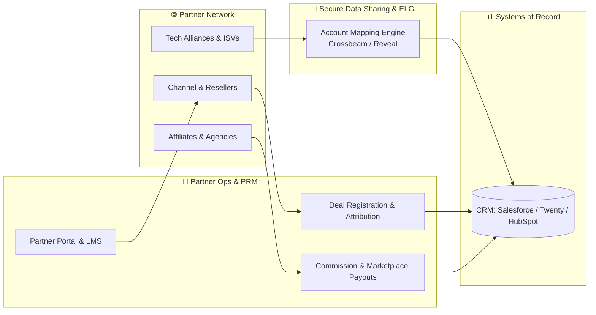
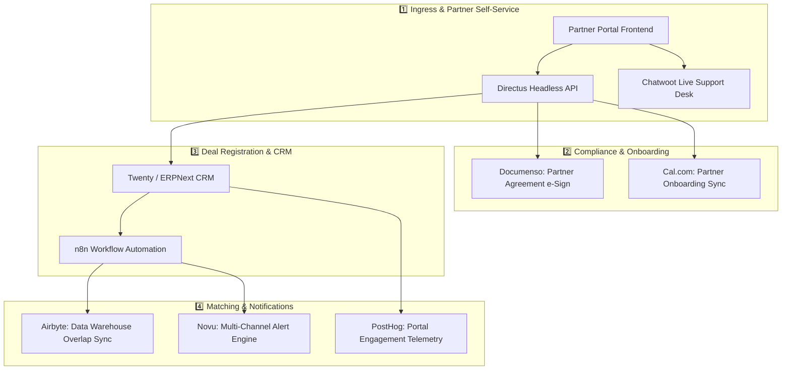
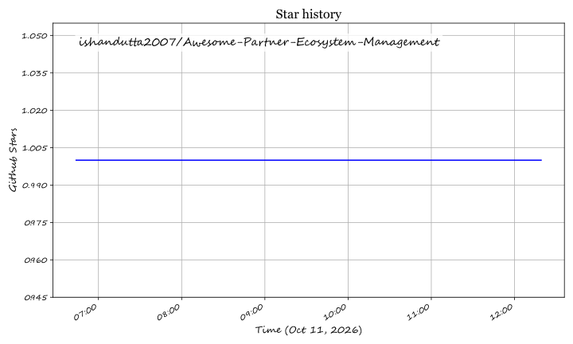

  

<h1 align="center">🤝 Awesome Partner Ecosystem Management 🌐</h1>

  <strong>Curated directory of SaaS platforms, open-source alternatives, PRM suites, co-selling engines, account mapping tools, and developer APIs for partner ecosystem orchestration.</strong>

  
  
  
  
  
  

---

## 📌 Overview & Industry Landscape

**Partner Ecosystem Management** encompasses modern software systems enabling B2B companies to recruit, onboard, manage, co-sell, track attributions, and share secure data across technology alliances, channel partners, value-added resellers (VARs), and system integrators. 

Traditional **Partner Relationship Management (PRM)** has evolved from static portal directories into interconnected **Ecosystem-Led Growth (ELG)** engines that integrate directly into CRM workflows (Salesforce, HubSpot) to reveal overlapping accounts, automate co-selling cadences, and distribute partner payouts.

---

## 📑 Table of Contents

- [🏢 SaaS & Commercial Hosted Platforms](#-saas--commercial-hosted-platforms)
- [💻 Open-Source Alternatives & Developer Tools](#-open-source-alternatives--developer-tools)
  - [🤝 CRM & Partner Lifecycle Management](#-crm--partner-lifecycle-management)
  - [🔄 Workflow Orchestration & Data Integration](#-workflow-orchestration--data-integration)
  - [📦 Composable Commerce & Partner Portals](#-composable-commerce--partner-portals)
  - [📑 Contracts, Scheduling & Communication](#-contracts-scheduling--communication)
  - [📈 Product Analytics & Feature Experimentation](#-product-analytics--feature-experimentation)
- [🏗️ Ecosystem Architecture Blueprint](#️-ecosystem-architecture-blueprint)
- [🤝 How to Contribute](#-how-to-contribute)
- [💖 Support](#-support)
- [📈 Star History](#-star-history)
- [📜 License](#-license)

---

## 🏢 SaaS & Commercial Hosted Platforms

> 📊 **Market Size & Structure Analysis:** The global Partner Relationship Management (PRM) and Partner Ecosystem Management software market is estimated at **$1.6B–$2.1B in 2026** (projected to exceed **$3.8B by 2030** at ~14.5% CAGR). The sector is **moderately fragmented**: mega-cap cloud providers (Salesforce) command dominant baseline CRM distribution, while a fiercely competitive tier of specialized pure-play platforms (Crossbeam, Reveal, PartnerStack, Impact.com, WorkSpan, Impartner) compete across specialized verticals like account mapping, influencer partnerships, and co-selling networks.

The following table lists leading commercial platforms providing partner portal infrastructure, ecosystem co-selling, account mapping, and channel automation.

> *Sorted descending by Company Size (Enterprise Valuation / Market Cap / Scale).*

| Product | Company Size & Valuation | Focus & Core Capabilities | Starting Pricing | Free Tier / Free Trial Limits |
| :--- | :--- | :--- | :--- | :--- |
| **[Salesforce AppExchange Partner Program](https://partners.salesforce.com/)** | **~$280B+** Market Cap (CRM) • **~$38B+** Annual Revenue • 7,000+ Apps | Global enterprise cloud marketplace and ISV partner program for publishing, co-marketing, and licensing managed packages within Salesforce. | **$150/user/month** (Salesforce PRM add-on on top of Sales Cloud Enterprise; $2,550/app initial ISV listing fee + 15% revenue share) | **30-day free trial** of Salesforce Enterprise with full PRM sandbox capabilities; free access to Salesforce Trailhead partner learning curriculum. |
| **[Crossbeam](https://www.crossbeam.com/)** | **~$1.0B+** Valuation *(Merged with Reveal in 2024)* • **~$60M+** ARR • 25,000+ Connected Companies | Collaborative account-mapping data network allowing B2B companies to overlap customer and prospect lists without exposing confidential data. | **$499/month** (Connector tier billed annually; Supernode tier at $1,499/month for unlimited CRM field overlaps and pipeline forecasting) | **Free Forever plan** with **up to 3 partner network connections** and basic account overlaps; **14-day free trial** for premium CRM integration connectors. |
| **[Impact.com](https://impact.com/)** | **~$1.5B–$2.0B** Unicorn Valuation *(Pre-IPO)* • **~$200M+** Annual Revenue | Comprehensive partnership automation management covering affiliates, brand-to-brand partnerships, publishers, and influencer compensation. | **$500/month** (Starter tier for SMB partnerships; Pro and Enterprise custom tiers from $2,500/month based on partner gross transaction volume) | **No free forever plan**; **30-day guided sandbox demo & trial** available on request with capped evaluation partner invites. |
| **[PartnerStack](https://partnerstack.com/)** | **~$500M** Valuation *(Series B)* • **~$35M+** Annual Revenue | End-to-end B2B SaaS partner platform built specifically for affiliate, referral, and reseller recruitment, automated tracking, and payout processing. | **$800/month** (Core starter tier billed annually for single-program management; multi-program tiers starting at $1,500/month) | **No free forever plan**; **14-day live sandbox evaluation** for verified B2B vendors with mock partner accounts and API testing. |
| **[WorkSpan](https://www.workspan.com/)** | **~$250M** Valuation *(Series C, $80M+ Raised)* • **~$25M+** Annual Revenue | Enterprise Ecosystem Cloud for hyper-scale cloud co-selling across hyperscalers (Microsoft Azure, AWS, Google Cloud) and strategic GTM teams. | **$1,500/month** (Base co-sell tier for single hyperscaler connection; enterprise multi-cloud setups start at $4,000/month) | **No free forever plan**; **30-day Proof of Value (POV)** evaluation sandbox with live CRM pipeline synchronization on test opportunities. |
| **[Impartner PRM](https://impartner.com/)** | **~$200M** Valuation *(Backed by Brighton Park Capital)* • **~$40M+** Annual Revenue | Dedicated enterprise PRM solution featuring automated deal registration, channel marketing automation (TCMA), partner tiering, and localized portals. | **$2,000/month** (Base platform package up to 100 active partner users; includes deal registration, partner portal, and standard CRM connector) | **No free forever plan**; **14-day guided sandbox access** with pre-configured partner portals, test certifications, and deal flows. |
| **[Zift Solutions](https://ziftsolutions.com/)** | **~$150M** Valuation *(Backed by Investcorp)* • **~$30M+** Annual Revenue | Enterprise Channel as a Service (ZiftONE) unifying channel marketing automation, PRM workflows, partner onboarding, and lead distribution in one UI. | **$1,750/month** (ZiftONE Core tier billed annually; enterprise multi-tier channel tiers scale to $4,500+/month) | **No free forever plan**; **30-day proof-of-concept (POC)** sandbox environment with custom partner landing pages and deal registration templates. |
| **[Reveal](https://reveal.co/)** | **~$150M+** Valuation *(Merged with Crossbeam)* • **~$15M+** ARR • 15,000+ Global Partners | Ecosystem-Led Growth (ELG) platform turning partner relationships into pipeline with real-time account matching, 360° account mapping, and CRM widgets. | **$399/month** (Pro plan billed annually; includes CRM push sync and account executive collaboration widgets) | **Free Forever plan** offering **unlimited basic partner connections** and manual CSV account matching; **14-day free trial** of Pro features. |
| **[Allbound PRM](https://www.allbound.com/)** | **~$70M** Valuation *(Backed by Invictus Growth Partners)* • **~$15M+** Annual Revenue | Modern, mobile-responsive partner portal providing channel enablement, deal registration, content distribution, and automated commission tracking. | **$795/month** (Standard plan billed annually for emerging partner programs; Growth tier at $1,495/month with custom domain and LMS) | **No free forever plan**; **14-day interactive test sandbox** with pre-loaded demo collateral, deal pipelines, and reward tracking modules. |
| **[Pronto](https://www.pronto.io/)** | **~$40M** Valuation *(Seed/Series A)* • **~$5M+** Annual Revenue | Ecosystem management software powering cross-company collaborative workflows, joint business planning (JBP), and co-sell governance. | **$650/month** (Team tier billed annually for up to 5 partner collaborative workspaces; Enterprise tier starts at $1,800/month) | **14-day free trial** with access to 2 joint partner workspaces, shared pipeline tracking, and document collaboration tools. |

---

## 💻 Open-Source Alternatives & Developer Tools

The following open-source repositories provide foundational building blocks to self-host custom partner portals, ecosystem CRMs, account-matching pipelines, automated webhook distribution, and affiliate commission management.

> *Sorted descending by GitHub Stars_Count.*

### 🤝 CRM & Partner Lifecycle Management

- **[Twenty](https://github.com/twentyhq/twenty)**   
  *58,100+ Stars* • The modern, open-source CRM alternative to Salesforce. Built with TypeScript and React, featuring custom relational data models, role-based partner access controls, extensible REST/GraphQL APIs, and Kanban deal pipelines ideal for custom PRM architectures.

- **[Odoo](https://github.com/odoo/odoo)**   
  *54,900+ Stars* • Comprehensive open-source business application suite including dedicated Reseller Management, Partner Portals, Lead Forwarding, Deal Registration, Affiliate Commission rules, and CRM pipeline automation.

- **[ERPNext (Frappe)](https://github.com/frappe/erpnext)**   
  *39,900+ Stars* • Modular 100% open-source ERP system featuring native Partner and Distributor modules, multilevel commission calculation, quotation and deal delegation, and partner self-service customer portals.

- **[SuiteCRM](https://github.com/SuiteCRM/SuiteCRM)**   
  *5,700+ Stars* • Battle-tested open-source enterprise CRM offering dedicated Channel Partner Management modules, shared lead distribution, opportunity registration, and granular role hierarchies.

- **[EspoCRM](https://github.com/espocrm/espocrm)**   
  *3,400+ Stars* • Lightweight, ultra-fast web-based CRM with customizable partner portal roles, multi-entity relationships, automated lead routing, and complete API coverage.

---

### 🔄 Workflow Orchestration & Data Integration

- **[n8n](https://github.com/n8n-io/n8n)**   
  *206,900+ Stars* • Fair-code workflow automation engine with 400+ native integrations. Seamlessly connect partner webhooks, synchronize deal registrations between external CRMs, and automate cross-organization partner alerts.

- **[Directus](https://github.com/directus/directus)**   
  *38,300+ Stars* • Real-time backend and headless data platform with granular role-based access control (RBAC). Perfect for constructing self-hosted partner directory portals and secure multi-tenant partner databases.

- **[Activepieces](https://github.com/activepieces/activepieces)**   
  *24,900+ Stars* • Open-source no-code business workflow automation alternative to Zapier. Embed partner onboarding triggers, synchronize lead registries, and coordinate multi-step partner notifications.

- **[Airbyte](https://github.com/airbytehq/airbyte)**   
  *22,200+ Stars* • The leading open-source data movement and ELT platform. Ideal for building private, privacy-preserving account mapping pipelines between partner data warehouses and internal CRMs.

---

### 📦 Composable Commerce & Partner Portals

- **[NocoDB](https://github.com/nocodb/nocodb)**   
  *65,200+ Stars* • Open-source smart spreadsheet and Airtable alternative. Rapidly deploy custom partner collaboration boards, joint business plans (JBPs), and shared opportunity tracking views.

- **[Medusa](https://github.com/medusajs/medusa)**   
  *36,600+ Stars* • Composable commerce engine for building multi-vendor digital marketplaces, B2B partner distribution portals, custom wholesale pricing tiers, and reseller catalogs.

- **[Crater](https://github.com/crater-invoice-inc/crater)**   
  *8,300+ Stars* • Open-source invoicing and billing tool for tracking reseller invoices, processing partner commission payments, and maintaining audit logs.

---

### 📑 Contracts, Scheduling & Communication

- **[Cal.com](https://github.com/calcom/cal.diy)**   
  *48,900+ Stars* • Open-source scheduling infrastructure enabling seamless joint partner co-selling calls, partner manager office hours, and round-robin onboarding meetings.

- **[Novu](https://github.com/novuhq/novu)**   
  *40,100+ Stars* • Open-source notification infrastructure delivering transactional emails, SMS, in-app badges, and Slack/Teams alerts for deal status changes and partner announcements.

- **[Chatwoot](https://github.com/chatwoot/chatwoot)**   
  *37,600+ Stars* • Open-source customer engagement suite for providing dedicated live-chat and ticketing support channels directly inside partner portals.

- **[Documenso](https://github.com/documenso/documenso)**   
  *15,300+ Stars* • The open-source DocuSign alternative for automating partner non-disclosure agreements (NDAs), master services agreements (MSAs), and joint co-selling contracts.

- **[Mautic](https://github.com/mautic/mautic)**   
  *10,700+ Stars* • Open-source marketing automation engine for Through-Channel Marketing Automation (TCMA), co-branded email nurturing campaigns, and partner lead generation.

---

### 📈 Product Analytics & Feature Experimentation

- **[PostHog](https://github.com/PostHog/posthog)**   
  *40,200+ Stars* • Complete product intelligence suite with session replay, feature flags, and cohort analytics to measure partner portal adoption and engagement metrics.

- **[GrowthBook](https://github.com/growthbook/growthbook)**   
  *8,400+ Stars* • Open-source feature flagging and A/B testing platform to progressively roll out new partner portal tiers and marketplace beta integrations.

---

## 🏗️ Ecosystem Architecture Blueprint

Organizations scaling beyond ad-hoc spreadsheets can build a resilient, privacy-conscious partner infrastructure by combining modern open-source modules:

---

## 🤝 How to Contribute

Contributions are warmly encouraged! To propose a new SaaS platform or open-source tool:

1. **Fork** this repository.
2. Create your feature branch (`git checkout -b feature/add-new-prm-tool`).
3. Maintain accurate pricing, transparent free tier limits, verified company valuation data, and GitHub Stars_Badges (`style=social&color=white`).
4. Keep the **SaaS / Commercial Hosted Platforms** section and **Open-Source Alternatives** section strictly separate.
5. Submit a **Pull Request** detailing why the tool is a fit for the partner ecosystem management ecosystem.
6. Check out [Awesome Awesome Awesome](https://github.com/ishandutta2007/Awesome-Awesome-Awesome) for more curated tech stacks.

---

## 💖 Support

Thank you for visiting and supporting this ecosystem initiative! If this repository helped you discover tools, architect your partner stack, or streamline your ecosystem operations, please consider showing your support:

- 🌟 **Star this repository** to help others discover it across GitHub.
- 🍴 **Fork it** and contribute your own tools, PRM integrations, or reviews.
- 📢 **Share it** with your network, partner marketing teams, and fellow developers.
- ☕ **Buy a coffee & sponsor ongoing maintenance:** [Sponsor Dashboard on GitHub](https://github.com/sponsors/ishandutta2007)

---

## 📈 Star History

---

## 📜 License

This compilation is distributed under the [MIT License](file:///C:/Users/hp/Documents/Projects/Awesome-Partner-Ecosystem-Management/LICENSE). Built with 🤝 for partnership leaders, channel architects, and developers worldwide.

## Star History

<a href="https://star-history.com/#ishandutta2007/Awesome-Partner-Ecosystem-Management&Timeline" align="center">
  <picture>
    <source media="(prefers-color-scheme: dark)" srcset="assets/ishandutta2007_Awesome-Partner-Ecosystem-Management_growth.svg">
    
  </picture>
</a>
